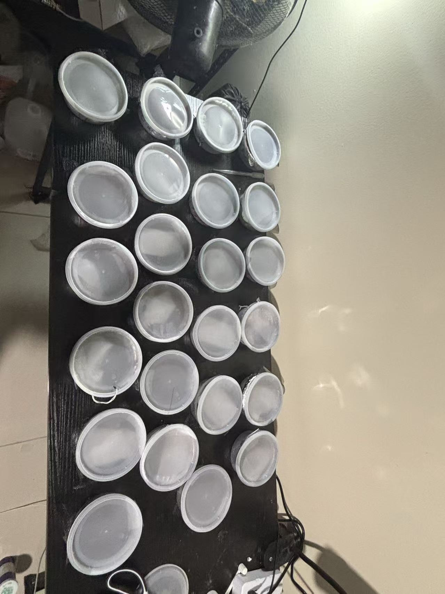
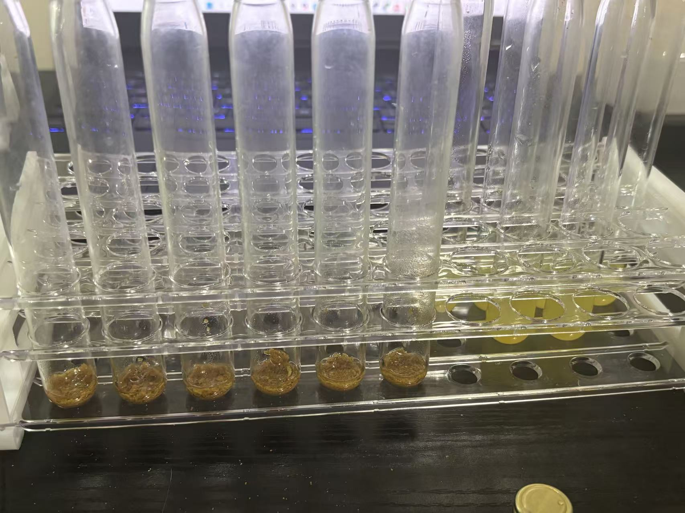

# Cat Food Storage Study and Automatic Feeder

How do container type and silica gel affect dry cat food while it waits to be dispensed? I compared plastic and aluminum foil containers with 0, 1, 2, or 4 g of silica gel. Each of the eight groups had three independent containers with 30 g of cat food each. The question grew out of building an automatic feeder with Shuoqi Yang and Shaoxuan Xiong.

[Full experiment report (PDF)](reports/cat-food-storage-experiment.pdf) · [Report data tables (CSV)](reports/cat-food-storage-report-tables.csv) · [Results](#results) · [Experiment photos](#experiment-photos) · [Feeder prototype and CAD](#prototype-and-mechanism)

## What I measured

- **Loss on drying (LoD).** I weighed samples before and after heating and used the percentage of mass lost as an indicator of moisture. Heating can also remove other volatile substances.
- **Iodine spot test.** I stained spots from hexane extracts with iodine and measured their integrated intensity in ImageJ. The intensity is a relative signal from lipid-soluble compounds in the extracts.
- **pH.** I measured the pH of aqueous cat-food extracts. Because of calibration limitations, I compared samples within each day.

## Results

Silica gel reduced loss on drying in both container types on Day 14. By Day 21, the reduction relative to the control persisted only in foil. The 1 g and 2 g foil groups had higher iodine spot signals than the foil control on Day 21, and their differences from the plastic control were inconclusive. Foil had lower pH than plastic at 0 g and 4 g that day. Next, I would test foil with silica gel in the feeder's storage compartment under different humidity conditions.

**Day 21 group means** (3 independent containers per group)

| Silica gel | Plastic LoD | Foil LoD | Plastic iodine signal | Foil iodine signal |
| ---: | ---: | ---: | ---: | ---: |
| 0 g | 7.13% | 7.60% | 5,012 | 3,964 |
| 1 g | 7.27% | 6.70% | 4,380 | 5,003 |
| 2 g | 7.27% | 6.67% | 4,787 | 5,787 |
| 4 g | 7.10% | **4.50%** | 4,564 | 5,345 |

[LoD chart with error bars for Days 0, 14, and 21](assets/loss-on-drying.svg)

## Prototype and mechanism

| Assembly motion | Underside mechanism |
| --- | --- |
|  |  |

[CAD model (STL)](cad/automatic-cat-feeder.stl) · [Assembly animation (MP4)](assets/assembly-animation.mp4?raw=true) · [Underside animation (MP4)](assets/underside-animation.mp4?raw=true)

## My contribution

**Food storage experiment.** In our basement workshop, we often saw stored food go moldy. When I looked at how dry kibble would sit in the feeder's storage compartment between feedings, I wondered how moisture and the container material might affect spoilage. That question led me to design and run a study comparing plastic and aluminum foil containers at four silica gel doses. I analyzed the loss on drying, iodine spot intensity, and pH measurements and wrote the report.

**CAD assembly and motion.** I helped build the prototype and modeled the motor and gears for the feeder's underside drive. In CAD, I troubleshot assembly errors and part interference by working through which parts needed to move together and in what sequence. I resolved motion simulation issues and created the two animations above to show the complete assembly and the gear-driven mechanism underneath.

Shuoqi Yang led the mechanical design and fabrication and revised the outlet and guide path. Shaoxuan Xiong developed the motor controls and tested two motor configurations. [Team prototype and test videos](https://github.com/jw3422951-ops/automatic-cat-feeder-fork#project-videos) · [Mechanical design and full STEP assembly](https://github.com/jw3422951-ops/automatic-cat-feeder-fork/blob/main/docs/mechanical-design.md) · [Motor and automation](https://github.com/jw3422951-ops/automatic-cat-feeder-fork/blob/main/docs/motor-and-automation.md)

## Experiment photos

*Containers used in the storage experiment.*

*Cat-food samples during hexane extraction for the iodine spot test.*

[Back to my GitHub profile](https://github.com/jw3422951-ops)
