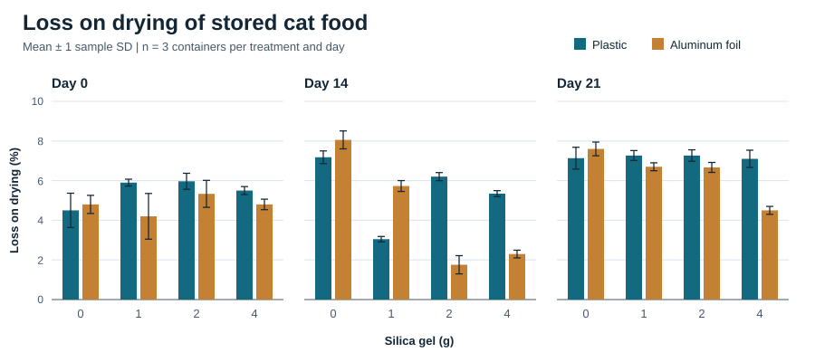
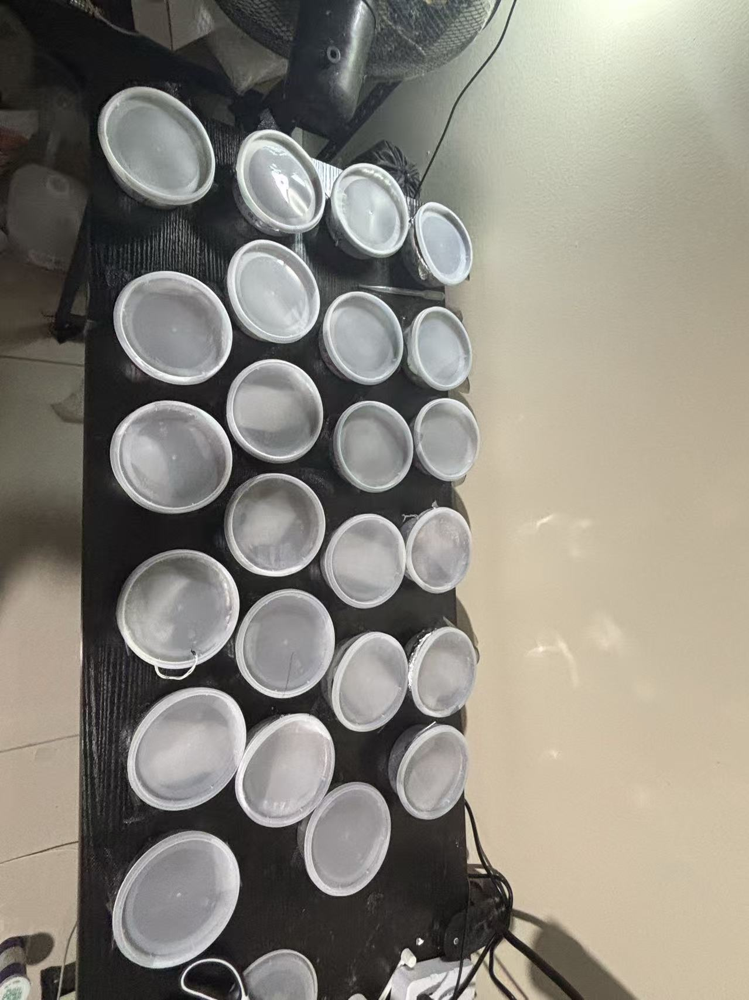
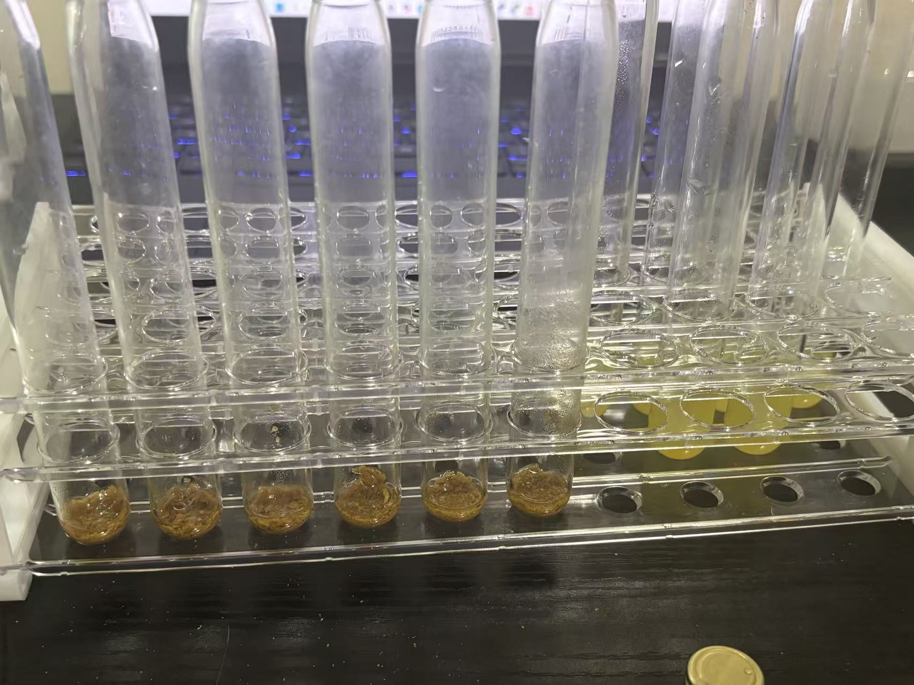

# Cat Food Storage Study and Automatic Feeder

How do container type and silica gel affect dry cat food while it waits to be dispensed? I designed and ran a study with 24 containers and wrote the report. I tracked loss on drying, pH, and an iodine spot signal from lipid-soluble extracts to understand what changes during storage. The question grew out of building an automatic feeder with Shuoqi Yang and Shaoxuan Xiong.

[Full experiment report (PDF)](reports/cat-food-storage-experiment.pdf) · [Results](#results) · [Experiment photos](#experiment-photos) · [Feeder prototype and CAD](#prototype-and-mechanism)

## Food chemistry and preservation

I compared plastic and aluminum foil containers with 0, 1, 2, or 4 g of silica gel. Each of the eight treatments used three independent containers with 30 g of cat food per container.

| Measurement | What I recorded |
| --- | --- |
| Loss on drying (LoD) | Mass lost during heating, used as a moisture-related indicator |
| Iodine spot test | I stained spots from hexane extracts with iodine and measured their integrated intensity with ImageJ |
| pH | Measurements of aqueous cat-food extracts |

### Results

- **Loss on drying.** On Day 14, all silica gel groups lost less mass during drying than their respective controls. By Day 21, the difference persisted only in foil. Mean loss on drying in foil was **7.60%, 6.70%, 6.67%, and 4.50%** at 0, 1, 2, and 4 g of silica gel. Without silica gel, Day 21 loss on drying was 7.60% in foil and 7.13% in plastic.
- **Iodine spot signal.** On Day 21, the 1 g and 2 g foil groups had higher spot intensities than the foil control. The differences from the plastic control were inconclusive. The correlation between loss on drying and spot intensity across the eight treatment means was also inconclusive (Pearson r = -0.59, p = 0.126).
- **pH.** On Day 21, foil groups had significantly lower pH than their matched plastic groups at 0 g and 4 g. Because of calibration limitations, I compared readings within each day.

*Bars show group means with one sample standard deviation above and below each mean (three independent containers per treatment and day). Table 1 in the [full report](reports/cat-food-storage-experiment.pdf) also lists the Day 0 means.*

Loss on drying can include volatile substances besides water. The iodine spot test gives a relative signal from the extracts. Next, I would test foil with silica gel in the feeder's storage compartment under different humidity conditions.

### Experiment photos

*Containers used in the storage experiment.*

*Cat-food samples during hexane extraction for the iodine spot test. I spotted the extracts onto a prewashed plate, stained the spots with iodine, and photographed them for ImageJ analysis.*

## Prototype and mechanism

The team built a feeder that moves dry food from a hopper through a motor-driven dispensing mechanism into a tray. Physical testing revealed jamming and leakage around the outlet. **Shuoqi Yang** led the mechanical design and fabrication and revised the outlet and guide path. **Shaoxuan Xiong** developed the motor controls and tested two motor configurations.

**My contribution.** I helped build the prototype, created CAD models of the motor and gears, assembled the components in CAD, and resolved interference between parts. I made the animations below to show how the assembly and underside mechanism move.

| Assembly motion | Underside mechanism |
| --- | --- |
|  |  |

[Team prototype and test videos](https://github.com/jw3422951-ops/automatic-cat-feeder-fork#project-videos) · [Mechanical design and full STEP assembly](https://github.com/jw3422951-ops/automatic-cat-feeder-fork/blob/main/docs/mechanical-design.md) · [Motor and automation](https://github.com/jw3422951-ops/automatic-cat-feeder-fork/blob/main/docs/motor-and-automation.md)

[CAD model (STL)](cad/automatic-cat-feeder.stl) · [Assembly animation (MP4)](assets/assembly-animation.mp4?raw=true) · [Underside animation (MP4)](assets/underside-animation.mp4?raw=true)

[Back to my GitHub profile](https://github.com/jw3422951-ops)
